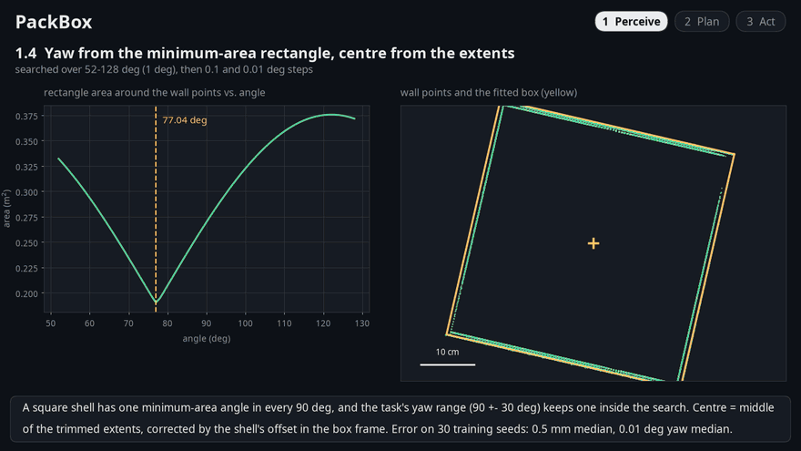
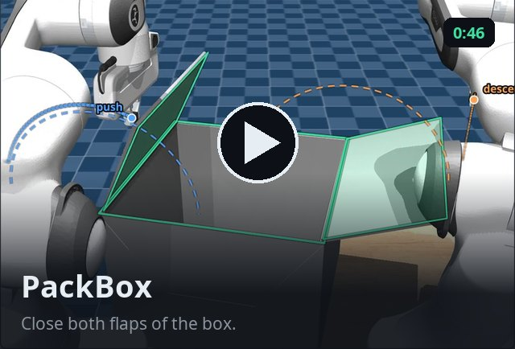
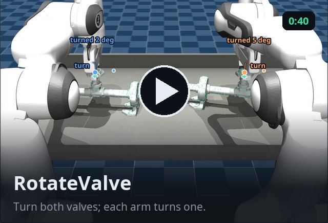
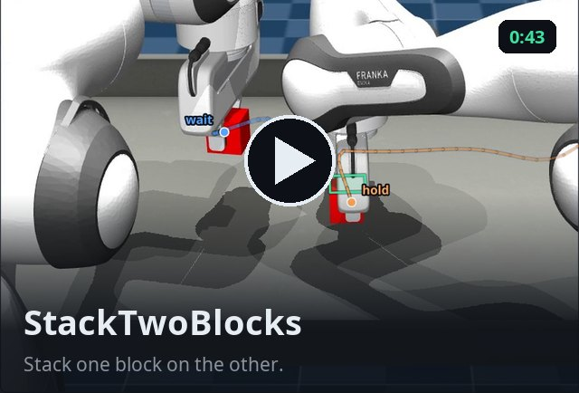
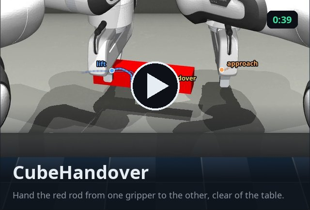
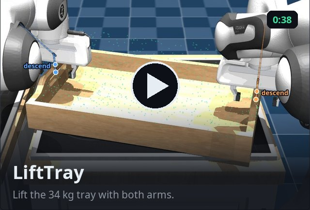
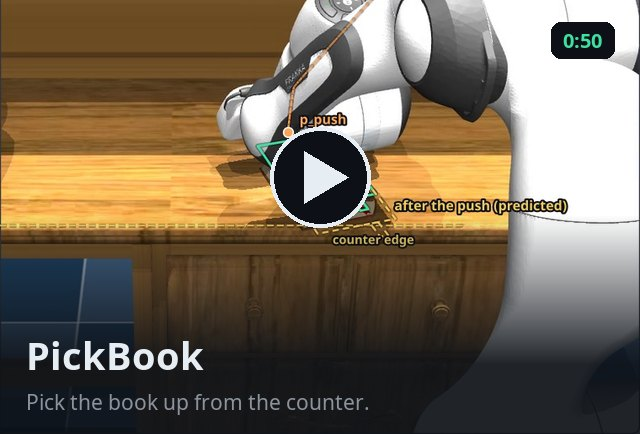
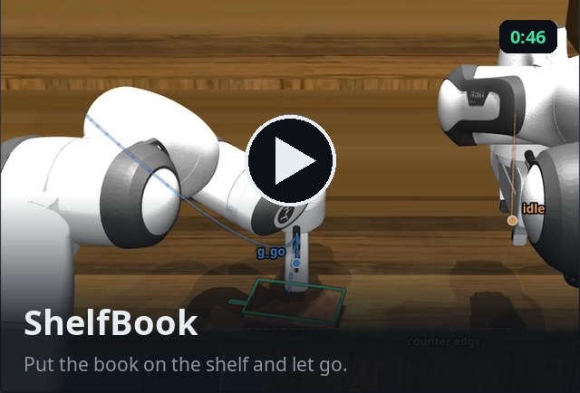
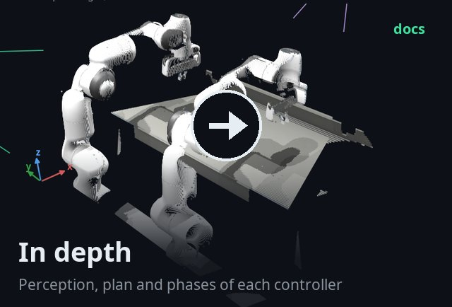
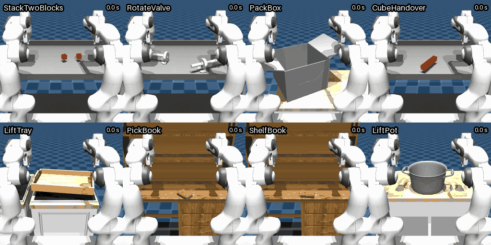

# LocalModels at the CoRL 2026 RoboEval Bimanual Challenge

Entry **ACT-bimanual** by team **LocalModels** (Saleh Alsharideh, Independent) to the
[CoRL 2026 RoboEval Diagnostic Bimanual Challenge](https://robo-eval.github.io/challenge.html).
**Official score 0.9861**, 399 of 400 episodes successful.

<p align="center"><a href="docs/controllers.md"></a></p>
<p align="center"><sub>Cut from the seven explainer videos: each controller's object fit, then its episode at 3x speed
with its estimates (green), planned paths (dashed) and phases.</sub></p>

Seven tasks run hand-designed controllers: depth images become 3-D points, a model of the object is fitted to them, and
a state machine per arm moves the hands. LiftPot runs an ACT policy trained on the demonstrations and fine-tuned in
simulation. The policy sees only the standard observations, never the simulator state.

<p align="center"></p>
<p align="center"><sub>The loop every controller runs. Each controller's own loops and phase machine:
<a href="docs/controllers.md">docs/controllers.md</a>.</sub></p>

## Explainer videos

One episode per controller, step by step: what it sees, the object it fits, its plan, and every phase of both arms.

<table>
<tr><td width="50%"><a href="assets/videos/PackBox.mp4"></a></td><td width="50%"><a href="assets/videos/RotateValve.mp4"></a></td></tr>
<tr><td width="50%"><a href="assets/videos/StackTwoBlocks.mp4"></a></td><td width="50%"><a href="assets/videos/CubeHandover.mp4"></a></td></tr>
<tr><td width="50%"><a href="assets/videos/LiftTray.mp4"></a></td><td width="50%"><a href="assets/videos/PickSingleBookFromTable.mp4"></a></td></tr>
<tr><td width="50%"><a href="assets/videos/StackSingleBookShelf.mp4"></a></td><td width="50%"><a href="docs/controllers.md"></a></td></tr>
</table>

## Results

Official run, seeds 1000-1049, 50 episodes per task.

| Task | Policy | Successes | Score |
|---|---|---|---|
| CubeHandover | controller | 50 | 1.000 |
| LiftPot | ACT ([training](training/README.md)) | 50 | 0.999 |
| LiftTray | controller | 50 | 1.000 |
| PackBox | controller | 49 | 0.954 |
| PickSingleBookFromTable | controller | 50 | 0.987 |
| RotateValve | controller | 50 | 1.000 |
| StackSingleBookShelf | controller | 50 | 1.000 |
| StackTwoBlocks | controller | 50 | 0.948 |
| **Suite** | | **399 / 400** | **0.9861** |

Per-metric scores: `results/official_results.json`. Episode logs:
[Hugging Face](https://huggingface.co/Sa74ll/LocalModels-ACT-bimanual/tree/main/official_run).

<p align="center"></p>
<p align="center"><sub>All eight tasks, one episode each, seed 2000, real time.</sub></p>

## Quick start

Needs [RoboEval](https://robo-eval.github.io/challenge.html) at tag `corl2026-challenge`.

```bash
git clone https://github.com/Sa74ll/RoboevalChallenge && cd RoboevalChallenge
pip install -r submission/policy/requirements.txt
bash scripts/download_weights.sh    # LiftPot weights (137 MB)

# all 8 tasks x 50 official seeds; W = parallel workers
python -m roboeval.challenge.evaluate --submission submission --workers W --gpus 0 --output-dir runs/official

# one episode as a GIF
MUJOCO_GL=egl python scripts/render_demo.py --tasks LiftTray --seed 2001 --out runs/lifttray.gif
```

The controllers give the same result every run; LiftPot can differ by an episode or two.

## Repository

```
submission/     the submitted bundle: metadata.yaml, policy/ (code), checkpoint/ (one folder per task)
docs/           controllers.md
scripts/        weight download, demo GIF, explainer videos, seed lists
training/       LiftPot training code and logs
results/        official results
report/         technical report
assets/         GIFs, videos, figures
```

## Use of simulator state

None at test time. During development, scene constants were read from the released assets, ground truth measured
perception errors, and LiftPot's expert and GRPO reward used simulator state. The organizers confirmed these uses are
allowed; the [report](report/report.pdf) (Sec. 3) lists them.

## Links

- Report: [report/report.pdf](report/report.pdf)
- Weights: [Sa74ll/LocalModels-ACT-bimanual](https://huggingface.co/Sa74ll/LocalModels-ACT-bimanual)
- GRPO rollouts: [Sa74ll/LocalModels-ACT-bimanual-rollouts](https://huggingface.co/datasets/Sa74ll/LocalModels-ACT-bimanual-rollouts)

## License

Apache-2.0. `modeling_act.py` is modified from LeRobot (Apache-2.0); two data files derive from RoboEval's assets
(MIT). See `NOTICE`.

## Citation

```bibtex
@misc{alsharideh2026diagnose,
  title        = {Diagnose, then Decide: From Simulator Fine-Tuning to Hybrid {RGB-D} Controllers for Bimanual
                  {RoboEval}},
  author       = {Alsharideh, Saleh},
  year         = {2026},
  note         = {Team LocalModels (ACT-bimanual), CoRL 2026 RoboEval Diagnostic Bimanual Challenge},
  howpublished = {\url{https://github.com/Sa74ll/RoboevalChallenge}}
}
```
