# How the seven controllers work

Seven of the eight tasks run a hand-designed controller (`submission/policy/hybrid_*.py`); LiftPot runs the learned
ACT policy. This page explains each controller in depth: what it sees, how it finds the object, what it plans, and the
phases each arm goes through. Each section opens with a diagram of the controller's feedback loops and phase machine.

Every controller has a **full explainer video** (MP4, 38-50 s) in [`assets/videos/`](../assets/videos). Each one walks
through the controller's perception stage by stage on the observation it actually planned from, then shows its plan and
then the episode at half speed, with the controller's estimates, planned paths, phases and gripper readings drawn in.
The GIF in each section is the episode part only, at full speed.

| Task | Explainer video | Controller code | Official run (50 seeds) |
|---|---|---|---|
| [StackTwoBlocks](#stacktwoblocks) | [StackTwoBlocks.mp4](../assets/videos/StackTwoBlocks.mp4) | `hybrid_s2b3.py`, `hybrid_s2b.py` | 50/50, score 0.948 |
| [RotateValve](#rotatevalve) | [RotateValve.mp4](../assets/videos/RotateValve.mp4) | `hybrid_rv.py`, `rv_perception.py` | 50/50, score 1.000 |
| [PackBox](#packbox) | [PackBox.mp4](../assets/videos/PackBox.mp4) | `hybrid_pb.py` | 49/50, score 0.954 |
| [CubeHandover](#cubehandover) | [CubeHandover.mp4](../assets/videos/CubeHandover.mp4) | `hybrid_ch.py`, `rod_perc.py` | 50/50, score 1.000 |
| [LiftTray](#lifttray) | [LiftTray.mp4](../assets/videos/LiftTray.mp4) | `hybrid_lt.py`, `lt_perc.py` | 50/50, score 1.000 |
| [PickSingleBookFromTable](#picksinglebookfromtable-pickbook) | [PickSingleBookFromTable.mp4](../assets/videos/PickSingleBookFromTable.mp4) | `hybrid_pk.py`, `pk_perception.py`, `pk_ik.py` | 50/50, score 0.987 |
| [StackSingleBookShelf](#stacksinglebookshelf-shelfbook) | [StackSingleBookShelf.mp4](../assets/videos/StackSingleBookShelf.mp4) | `hybrid_ss.py`, `ss_perc.py`, `ss_ik.py`, `ss_lib.py` | 50/50, score 1.000 |

The episodes in the videos use training seed 900000 (PickBook: 900001, the first of seeds 900000-900019 whose book had
to be pushed before the pinch), the same episodes as Fig. 2 of the [report](../report/report.pdf). They run the
submitted code through the evaluator's episode loop.

<p align="center">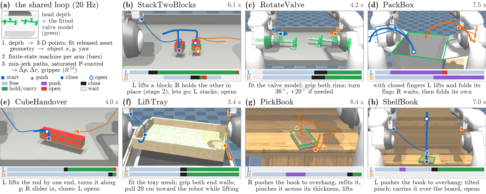</p>
<p align="center"><sub>One training-seed episode per controller: head camera at the start, the fitted object model
(green), the finger-pad paths (blue left arm, orange right arm) and each arm's phases over time (bars).</sub></p>

## The common recipe

<p align="center">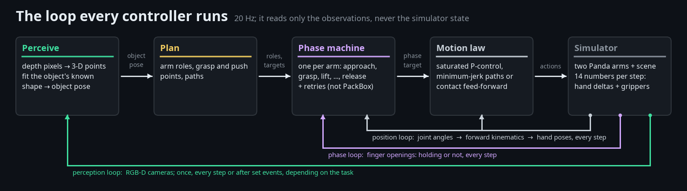</p>

Three loops close through the observations: hand poses from the joint angles steer the motion every step (position
loop), finger openings and hand poses move the phase machine on (phase loop), and the depth images update the object
estimate (perception loop: how often depends on the controller).

**What a controller reads.** Only the observation dictionary that `act()` receives: the head and front cameras' RGB and
depth images (256 x 256; `depth: true` in `metadata.yaml`), the joint angles (`proprioception`; PackBox also the joint
velocities) and the two finger openings (`proprioception_grippers`, 1 open, 0 closed). Nothing is read from the simulator. Camera poses, the field of
view and the objects' geometry were read once from the released scene and assets during development and are fixed
numbers or files in the code (see the README's "Use of simulator state").

<p align="center">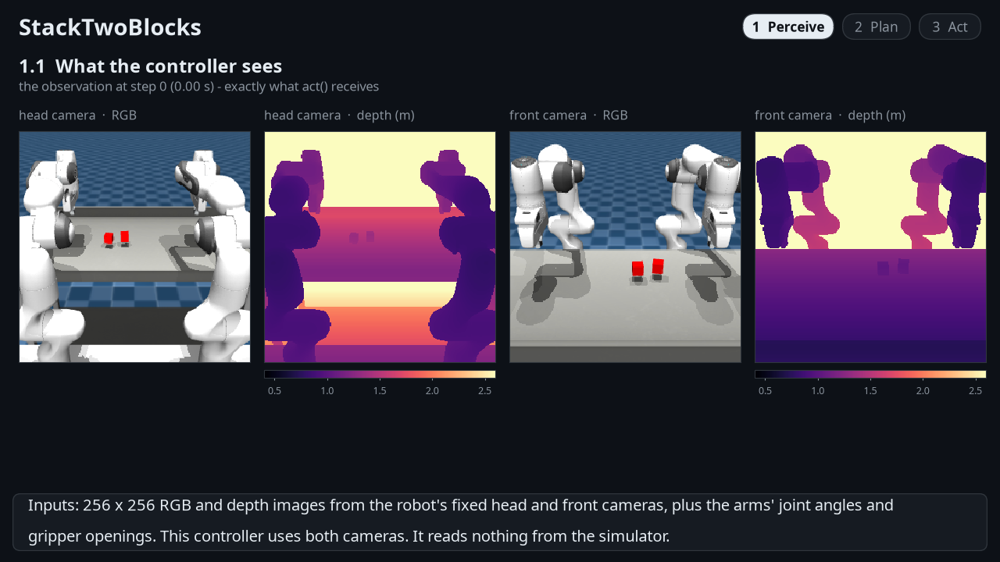</p>

**Depth pixels to 3-D points.** For pixel (u, v) with depth d, f = 128 / tan(45 deg / 2) = 309.0 px, and the point in
the camera frame is ((u + 0.5 - 128) d / f, -(v + 0.5 - 128) d / f, -d). The camera's fixed pose (R, c) maps it to the
robot frame: p = R x + c (`CAMS` and `_points` in `hybrid_s2b.py`). The cameras are mounted on the robot base, so the
same constants hold in every task.

<p align="center">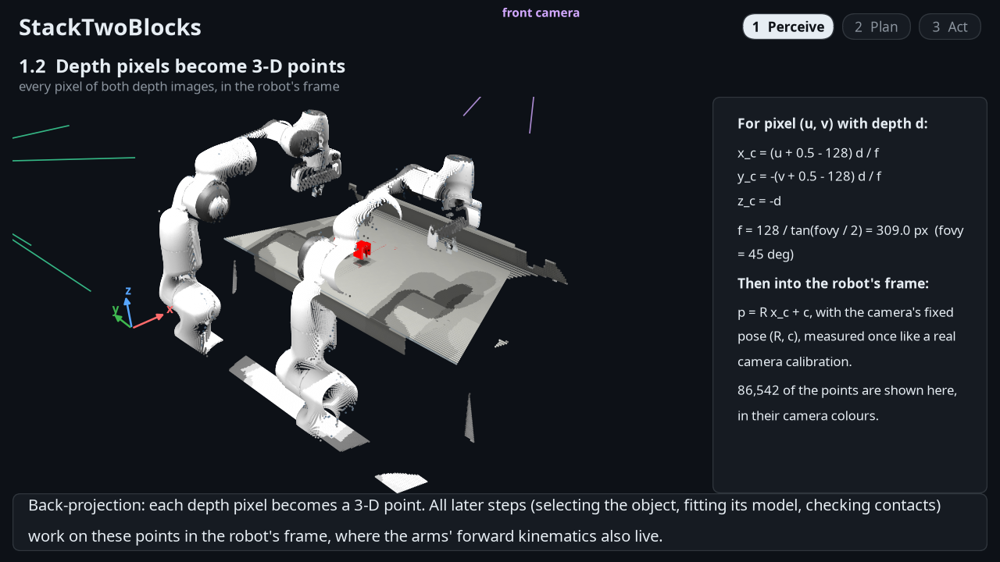</p>

**Where the hands are.** Forward kinematics of the Panda arms (modified DH parameters, arm bases at (0, +-0.3, 0.6) m)
from the joint angles: `hybrid_s2b.fk`. The finger opening tells whether a hand holds something; most controllers use
0.15-0.8 as "holding".

**How the arms move.** Three styles, chosen per task:

- *Saturated P-control* toward a target: each 50 ms step sends dp = clip(K_p (target - p), +-v_max) per axis
  (StackTwoBlocks, CubeHandover, and PackBox outside contact). LiftTray caps the length of K_p (target - p) instead,
  and slows the arm with less distance to go so both arrive together.
- *Minimum-jerk reference segments* sent as feed-forward increments, plus a small bounded correction toward the
  reference against gravity sag (RotateValve: only while the reference is still; PickBook and ShelfBook also while it
  moves).
- *Feed-forward contact paths* (PackBox): a virtual command moves along the flap's arc with a servo-lag feed-forward
  term, and its aim pauses when the hand lags or tilts.

**Actions.** 14 numbers per step: position and rotation deltas of the left and right end effectors (world-frame axes),
then the two gripper commands (0 open, 1 closed).

**Checks and recovery.** Every grasp is checked with the finger opening, and every grasping controller has a retry
path: re-open, look again, grasp again (a missed rim, a missed block, a dropped rod or book, a tray wall that slipped).
PackBox never grasps (it pushes with closed fingers) and has no retry path; it locates the box once.

**Reading the videos.** Blue is the left arm, orange the right arm; green is the controller's estimate of the object;
dashed lines are planned paths; the trails are the finger pads' recent path (thick while pushing or holding). The
timeline colours phases by kind: free motion, push, close, hold/carry/turn, open, wait.

---

## StackTwoBlocks

<p align="center">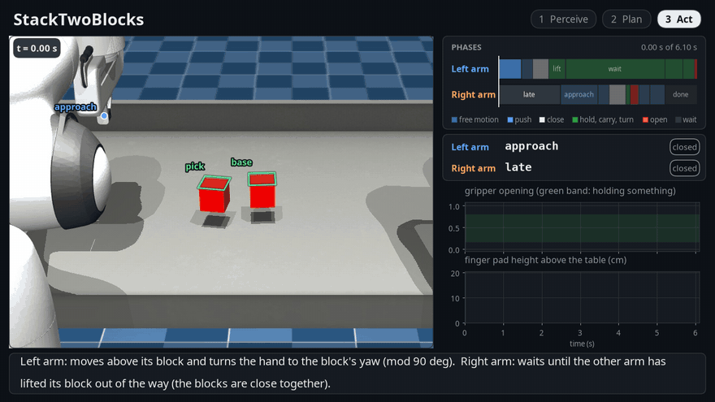</p>
<p align="center"><a href="../assets/videos/StackTwoBlocks.mp4">Full explainer video (MP4, 43 s)</a></p>

<p align="center">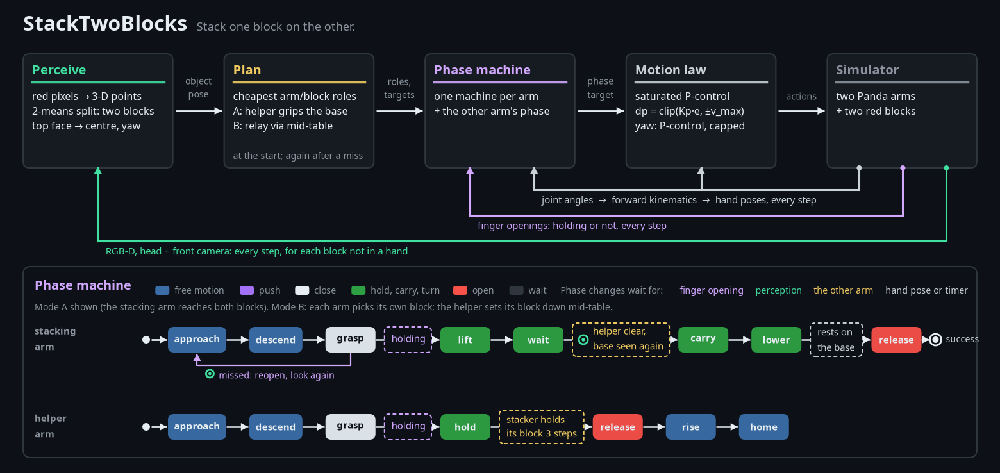</p>

**Perception** (`hybrid_s2b.locate`). Red pixels (R > 90, G < 70, B < 70) in both cameras become 3-D points between 0.9
and 1.4 m height. Starting from the two points farthest apart, a 2-means split on x-y separates the two blocks. Each
block's top face (points within 6 mm of its highest point) gives the centre; the yaw (mod 90 deg) is the angle of the
smallest bounding rectangle, searched in 1 deg steps. Accuracy on 40 training seeds: 1.1 mm and 0.6 deg. Every block not in
a hand is tracked on every step: a fresh estimate within 4 cm of the last one replaces it when its top face is clearly
visible and no hand is just above it.

<p align="center">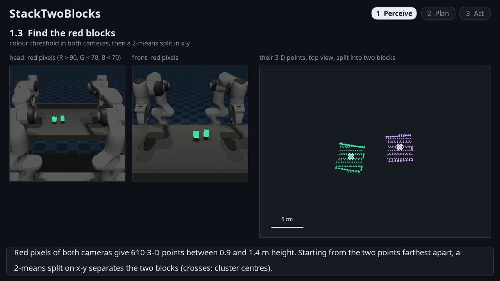 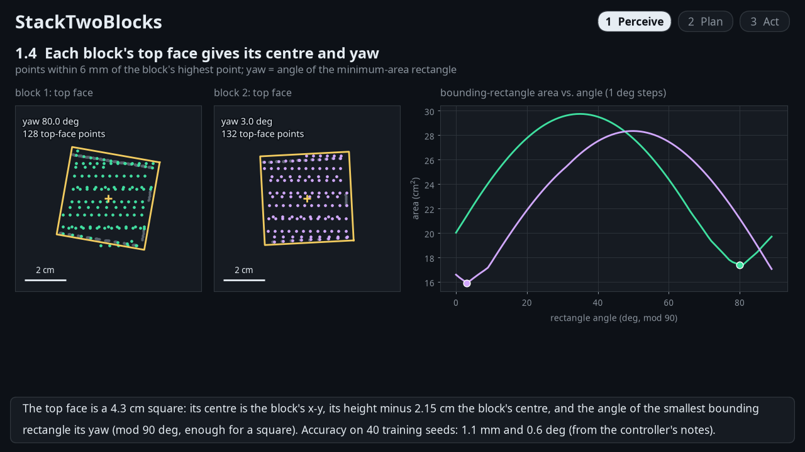</p>

**Plan** (once, at the first step). The cheapest (stacking arm, block to pick) assignment whose pick and place both lie
within 0.64 m of that arm's base is mode A: the stacking arm picks block P and stacks it on block B, while the other
arm grips B where it stands and holds it until the stacking arm holds P. Both blocks are then held at the same time,
which is the task's stage 2 (task progression counts it), and the two arms move together, which the coordination
metric rewards. If no arm reaches both blocks (far apart on opposite sides), mode B relays: each arm picks its own
block, one sets its block down at a meeting point mid-table and moves away, the other stacks onto it.

| Phase (stacking arm) | What it does | Ends when |
|---|---|---|
| approach | moves above its block, turning the hand to the block's yaw | within 1.2 cm of the point above and 6 deg of the yaw |
| descend | lowers straight down | height within 6 mm, x-y within 1 cm |
| grasp | closes for 10 steps | holding (opening 0.15-0.8): lift; otherwise reopen and approach again |
| lift | lifts the block to carry height | at carry height |
| wait | holds its block 14 cm from B, on the line from B to the held block | the helper has let go and moved away, and B has been seen again |
| carry, lower | carries the block over B's centre, lowers it | the block rests on B (or the descent stalls) |
| release | opens for 10 steps | success ends the episode |

| Phase (helper) | What it does | Ends when |
|---|---|---|
| late | waits (blocks closer than 12 cm) | the stacking arm has lifted P clear |
| approach, descend, grasp | as above, on block B | holding (a miss: the helper gives up its role and moves away) |
| hold | keeps B gripped in place | the stacking arm has held P for 3 steps |
| release, rise, home | opens, rises clear, steps 12 cm aside | out of the way |

## RotateValve

<p align="center">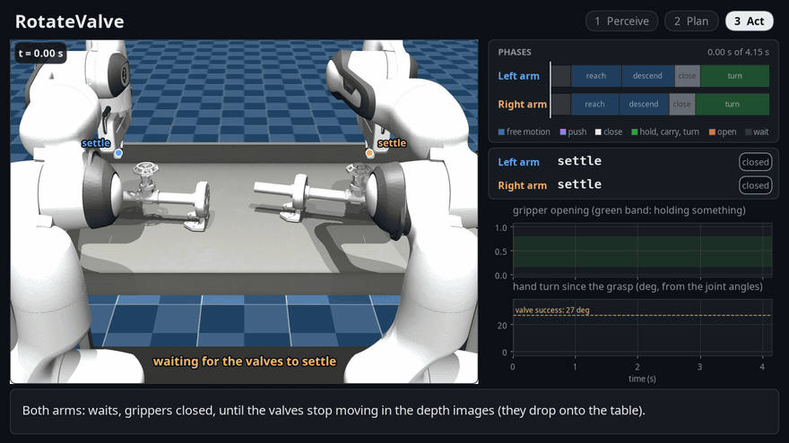</p>
<p align="center"><a href="../assets/videos/RotateValve.mp4">Full explainer video (MP4, 40 s)</a></p>

<p align="center">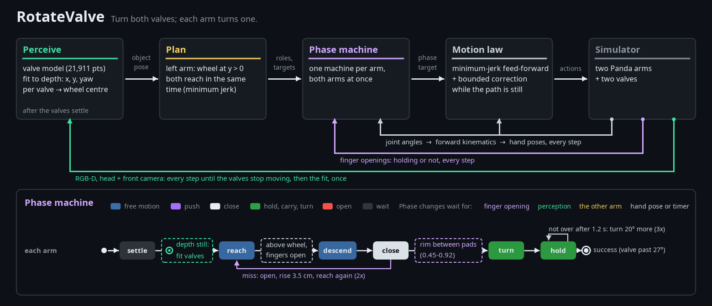</p>

**Settling.** The valves are free bodies: they drop about 2.7 mm onto the table in the first step and, in about 1-2% of
seeds where they spawn overlapping, push each other apart for several steps. The robot stays still, grippers closed,
until the valve region of both depth images stops changing (two steps in a row with at most 5 changed pixels;
typically 8-13 steps).

**Perception** (`rv_perception.py`). A point model of the valve (21,911 surface samples of the released valve meshes,
`rv_valve_pts.npy`) is registered to the depth points above the table. Each valve has 3 unknowns (x, y, yaw) because it
rests on the table at a known height. The search covers the task's spawn ranges on a 1 cm / 3 deg grid, then two finer
passes. The score of a pose is the number of depth points within 4 mm of the posed model, minus 3 times the model
points that a camera sees through (free space). Without that second term, a valve whose wheel is hidden by an arm
could slide along its pipe. The whole valve is fitted (pipe, flanges, bonnet, wheel) because at the start the arms
hide about 15% of the wheels. Median wheel error on 200 training seeds: 1.0 mm (90th percentile 2.6 mm).

<p align="center">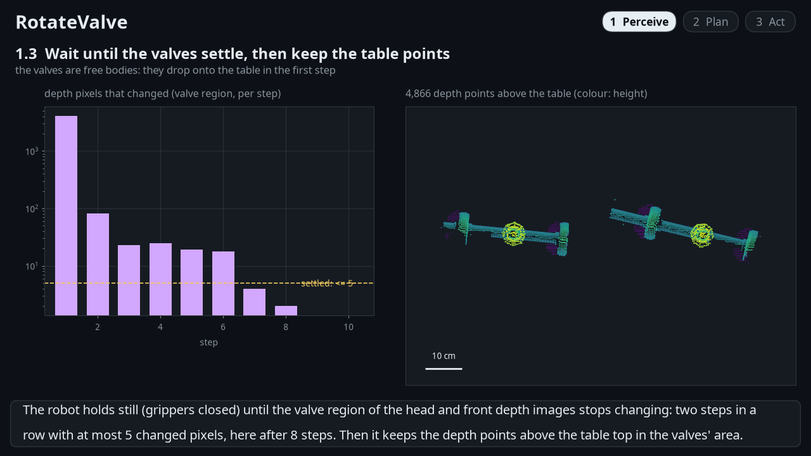 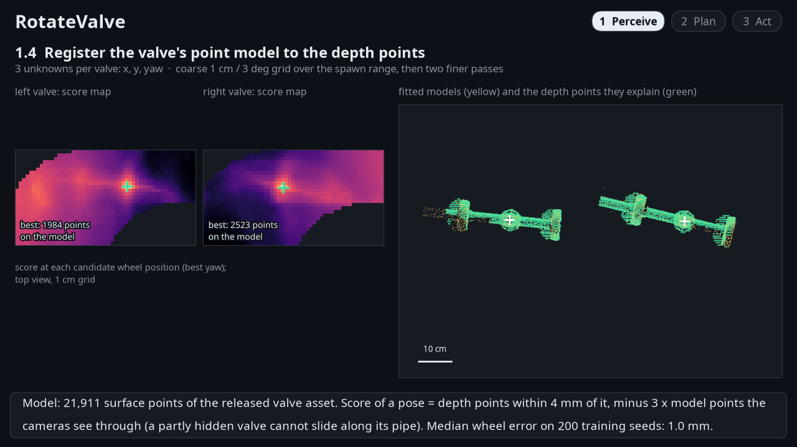</p>

**Plan.** The left arm takes the wheel with y > 0, the right arm the other. Both reach their wheel in the same time,
T = max(0.7 s, 0.5 s + 5 s/m x the longer distance), on minimum-jerk paths, so their heights and speeds stay matched.

| Phase (each arm) | What it does | Ends when |
|---|---|---|
| reach | opens, moves the hand above the wheel, pads 3.5 cm above their grasp height | path done, fingers open, x-y within 4 mm of the wheel axis |
| descend | lowers the pads around the rim in 0.8 s | height within 1.5 mm and x-y within 4 mm |
| close | closes for 10 steps | opening 0.45-0.92 (rim between the pads): turn; otherwise retry (at most twice) |
| retry | opens and rises 3.5 cm | reaches again, then descends |
| turn | rotates the hand 36 deg about the vertical through the wheel axis in 1.6 s | turn done |
| hold | keeps the grasp | success; or 1.2 s without success: turn 20 deg more (up to 3 times) |

Success needs each valve past 27 deg of its 270 deg range, so 36 deg leaves margin for a little slip.

## PackBox

<p align="center">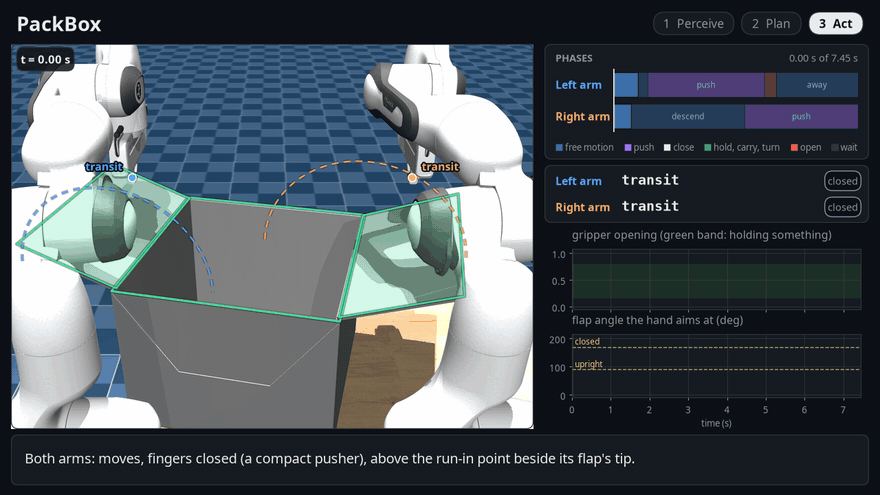</p>
<p align="center"><a href="../assets/videos/PackBox.mp4">Full explainer video (MP4, 46 s)</a></p>

<p align="center">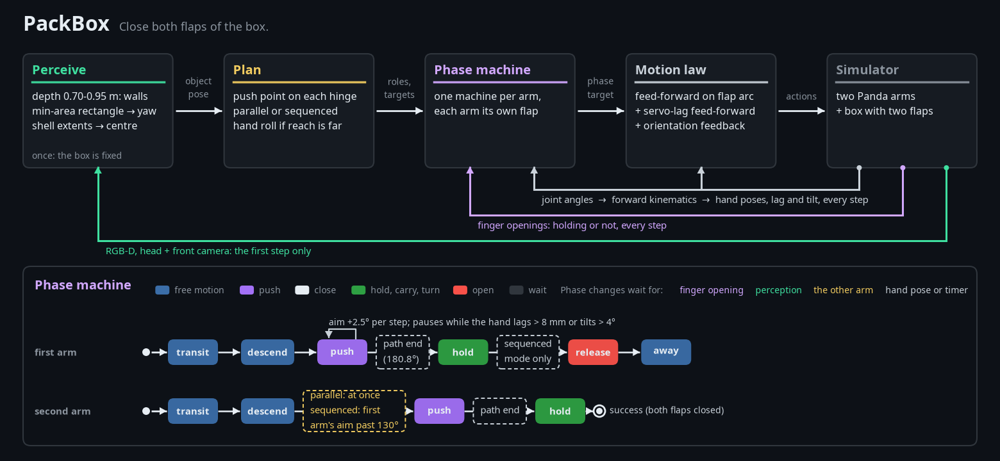</p>

**Perception** (`locate_box`). The box has no free joint, so its pose is estimated once, at the first step. At reset
only the box occupies the height band 0.70-0.95 m (below the hinges): those depth points are its wall shell, a square
seen from above. The yaw is the angle of the minimum-area rectangle around the shell, searched over 52-128 deg (1 deg,
then 0.1 and 0.01 deg); a square has one minimum in every 90 deg, and the task's yaw range (90 +- 30 deg) keeps one
inside the search. The centre is the middle of the shell's trimmed extents, corrected by the shell's offset in the box
frame. Error on 30 training seeds: 0.5 mm median (at most 1.7 mm), yaw 0.01 deg median.

<p align="center">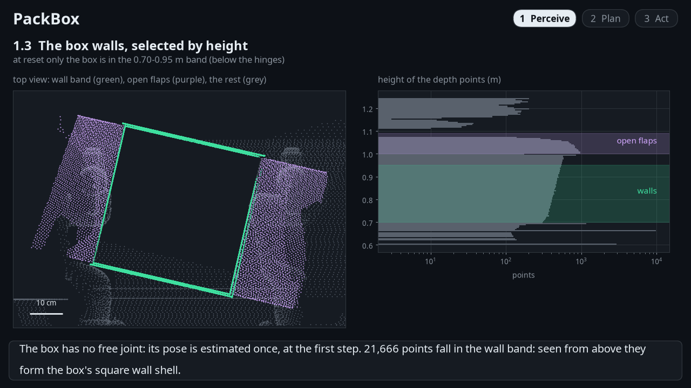 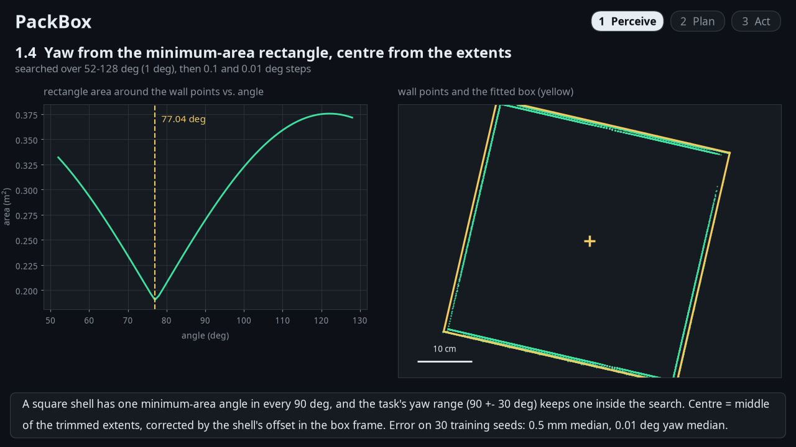</p>

**The pusher.** Both grippers stay closed: the two fingertip pads side by side form a compact pusher, with the hand
pointing down and the finger line along the hinge, so both pads touch the flap together. Up to 90 deg the pads' inner
face pushes the flap's tip edge (it rides 15 mm above the fingertip); past 90 deg the pads' inner bottom corner presses
the flap's outer face. Each arm holds its own flap on the way (the left arm the +x flap, the right arm the -x flap).

**Plan.** For each arm, a push position along the hinge (-0.18 to 0.18 m) whose largest shoulder-to-wrist distance
over the whole path is comfortable (below 0.70 m). Parallel mode if both arms can push comfortably 0.30 m apart; else
sequenced mode: the arm with the easier reach goes first, and the other waits at its run-in point until the first arm's
push has advanced its aim past 130 deg. If no position is comfortable (far boxes turned about 30 deg), the hand is rolled up to 28 deg during
the early lift.

| Phase (each arm) | What it does | Ends when |
|---|---|---|
| transit | free motion to 3 cm above the open flap's tip, fingers closed | within 2 cm |
| descend | to the run-in point beside the tip (sequenced mode: the second arm waits here, its height following the first arm's) | within 8 mm (and, for the second arm, the first arm's aim past 130 deg) |
| push | the aim angle advances 2.5 deg per step along the flap's arc; it pauses while the hand lags by more than 8 mm or tilts by more than 4 deg, but never stops past 95 deg unless overloaded | the end of the path (180.8 deg) is reached and held |
| hold | presses the closed flap and holds still | sequenced mode, first arm: lets go at once |
| release, away | opens, rises 4 cm, moves to its own side | the episode ends when both flaps are closed |

## CubeHandover

<p align="center">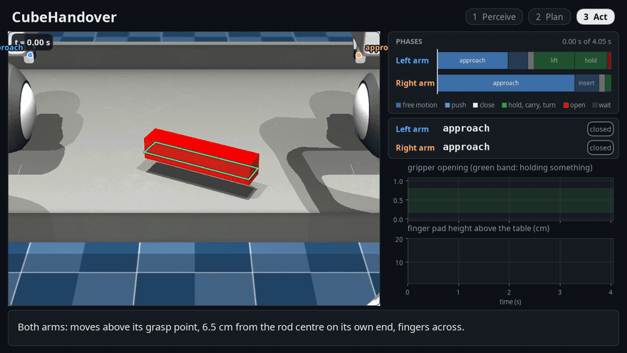</p>
<p align="center"><a href="../assets/videos/CubeHandover.mp4">Full explainer video (MP4, 39 s)</a></p>

<p align="center">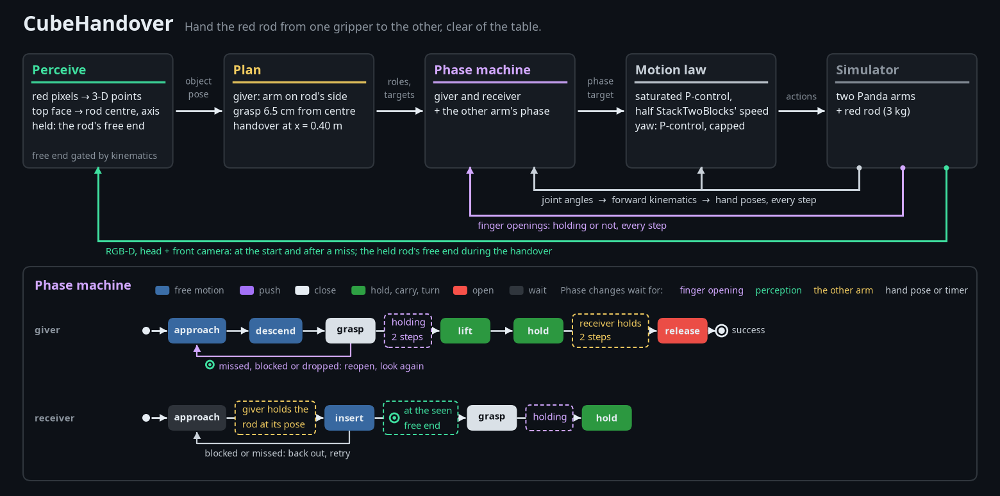</p>

**Perception** (`rod_perc.py`). The "cube" is a red rod, 4 x 20 x 4 cm, at any yaw. Red pixels of both cameras become
3-D points above the table. The rod's top face is the most populated 2 mm height bin: the side faces spread over 4 cm,
and a few "flying" silhouette pixels can lie up to 4 cm above the rod, so a plain maximum fails. The principal axis of
the top-face points is the rod's long axis; the centre is the middle of the trimmed extents along and across it. Once
the rod is lifted, the free end of the held rod is found the same way and used if it agrees with the kinematic
prediction.

<p align="center">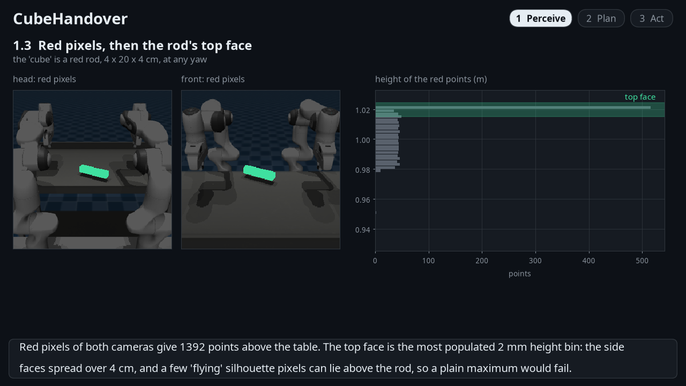 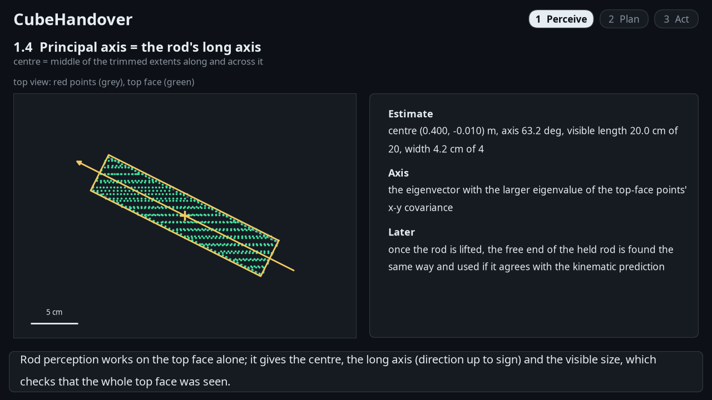</p>

**Plan.** The giver is the arm on the rod's side. It grasps the rod top-down 6.5 cm from the centre on its own end,
fingers across the rod, lifts it, and carries and turns it to the handover pose (rod centre at x = 0.40 m, along the y
axis, 6 cm up), stopping 5 cm short on its own side. The receiver waits 6 cm beyond its grasp point, out along the
rod's axis on its own side, then slides in with open fingers while the giver brings the rod the last 5 cm, so both arms
move during the insert. The speeds are half of StackTwoBlocks': the score compares the two arms' speeds, and the time
stays below the human demonstrations' median.

| Phase | Arm | What it does | Ends when |
|---|---|---|---|
| approach | giver | above its grasp point, hand turned across the rod | within 1.2 cm and 5 deg |
| descend | giver | straight down onto the rod | height and x-y within 6 mm (blocked or 45 steps: reopen) |
| grasp | giver | closes | holding for 2 steps: lift (15 steps without: reopen) |
| lift | giver | straight up, then to the handover pose, turning the rod | at the pose: hold |
| approach | receiver | waits at its waiting point | the giver holds the rod at its pose, and the receiver is within 1.5 cm and 5 deg of its waiting point |
| insert | receiver | slides in along the rod axis, fingers open | within 6 mm of its grasp point (blocked or 60 steps: back out, retry) |
| grasp, hold | receiver | closes, holds | holding for 2 steps |
| release | giver | opens | success: only the receiver holds the rod, off the table |

## LiftTray

<p align="center">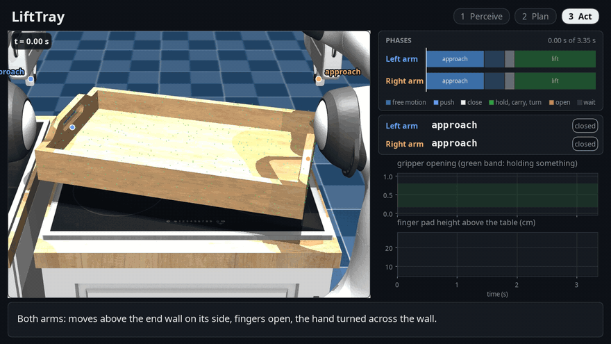</p>
<p align="center"><a href="../assets/videos/LiftTray.mp4">Full explainer video (MP4, 38 s)</a></p>

<p align="center">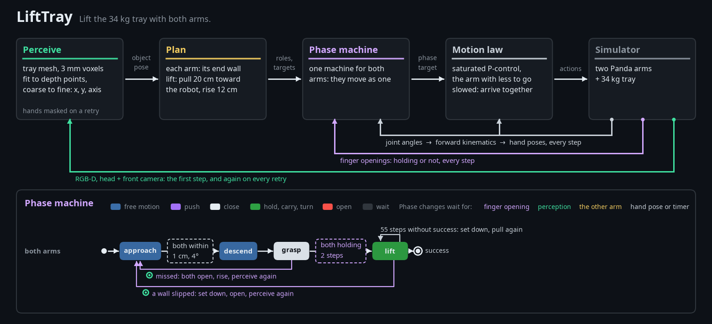</p>

**Perception** (`lt_perc.py`). The tray's visual mesh (744 vertices, 548 triangles of the released asset,
`tray_mesh.npz`) as an occupancy grid of 3 mm voxels, registered to the depth points in the tray's height band. The
tray floor is the most populated height, which fixes the tray's height even at the first observation, when the tray
still hangs 5.5 cm above the table. Score = points on the model surface. The coarse pass searches all 180 deg of the
long axis (the tray is symmetric under a half turn) in 3 deg steps and +-9 cm in 1.5 cm steps, with the model widened
by 21 mm so that wall points count before the pose is close; then 9 mm and 3 mm widening on finer grids. Without the
widened pass, the floor alone could not fix the position along the long axis (errors up to 5 cm). Accuracy on 160
training seeds: handle points within 4.2 mm (median 2.7 mm), axis within 0.65 deg.

<p align="center">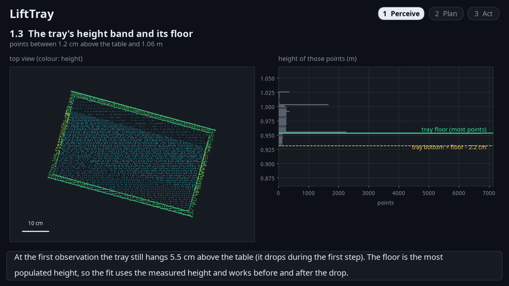 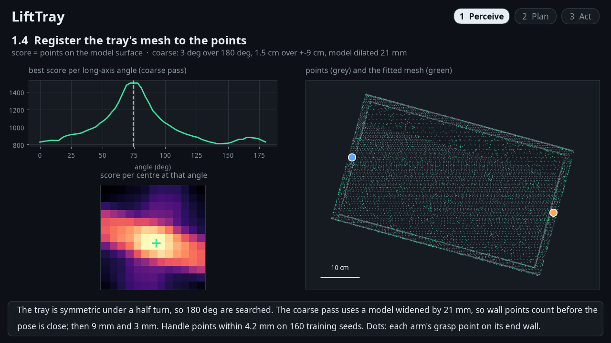</p>

**Plan.** Each arm takes the end wall on its side at the wall's middle, top-down, with the fingers 8 cm open around the
2.4 cm wall. The two arms move as one: the arm with less to go is slowed in proportion, so both arrive together and
stay at the same height (the score compares the arms' speeds and wrist heights). The lift pulls the tray 20 cm toward
the robot while rising 12 cm. Pulling is what makes the lift possible: holding 17 kg per hand at the handles' initial
distance saturates both shoulders and wrists, and the tray only tilts; about 20 cm closer the shoulders can lift it.

| Phase (both arms together) | What it does | Ends when |
|---|---|---|
| approach | above the end walls, fingers open, hand turned across the wall | both within 1 cm and 4 deg |
| descend | pads 1.6-4.0 cm below the wall top | both within 5 mm |
| grasp, ready | closes | both holding (0.15-0.8) for 2 steps; a miss: both retry |
| lift | pulls to tray centre x = 0.345 m while rising 12 cm | success; after 55 steps without it, the tray is set back down (grasp kept) and pulled again from there |
| setdown, retry | if a wall slips out of a hand: both hands go down, open, rise, the tray is perceived again | both grasp again |

## PickSingleBookFromTable (PickBook)

<p align="center">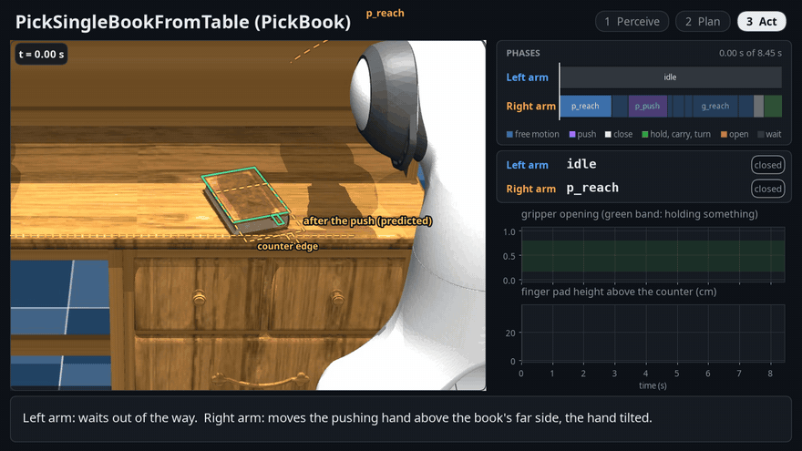</p>
<p align="center"><a href="../assets/videos/PickSingleBookFromTable.mp4">Full explainer video (MP4, 50 s)</a></p>

<p align="center">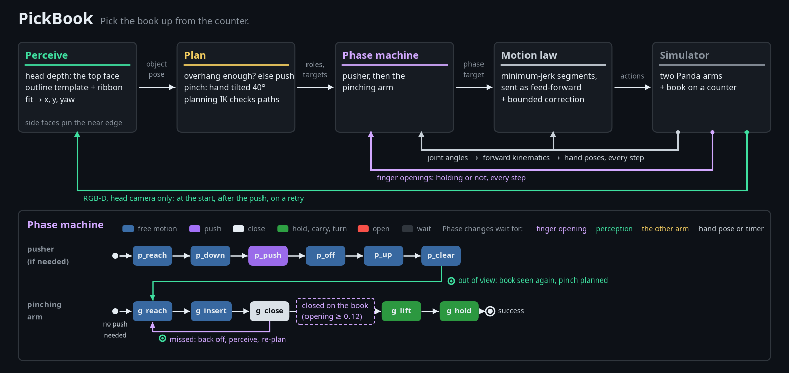</p>

**The problem.** The book can only be pinched across its thickness: the 8.2 cm gripper cannot span its 9.4 cm width,
and the pads' effective friction is too low for a corner pinch across the side faces. So one finger has to get under
the book, where it overhangs the counter's front edge.

**Perception** (`pk_perception.py`, head depth only: the front camera looks at the back of the bookshelf). The book's top
face is the dominant height 2-4 cm above the counter. The pose (x, y, yaw) is registered to a template of the book's
top outline: the 9.39 x 13.82 cm main block plus the ribbon bookmark (a 9.5 mm x 2.55 cm strip out of one end), which makes the
outline asymmetric and resolves the 180 deg ambiguity of a rectangle. Score = top points inside the outline + 2 x side
points on its edge (the side faces facing the camera, 6-20 mm above the bottom) - 2 x side points deep inside - 3 x
template points that the camera sees through. Without the side term the fit slid 4.7 mm toward the camera. The search
starts from the top face's minimum-area rectangle (all four axis assignments) and refines in 2, 1 and 0.5 mm steps.

<p align="center">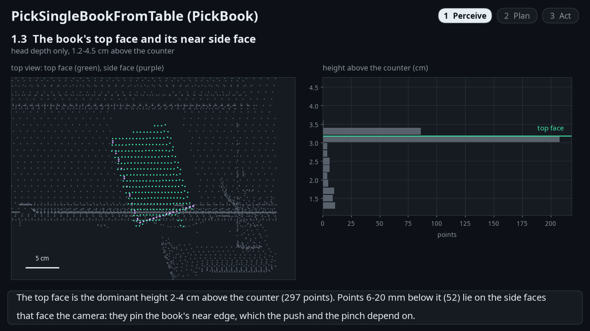 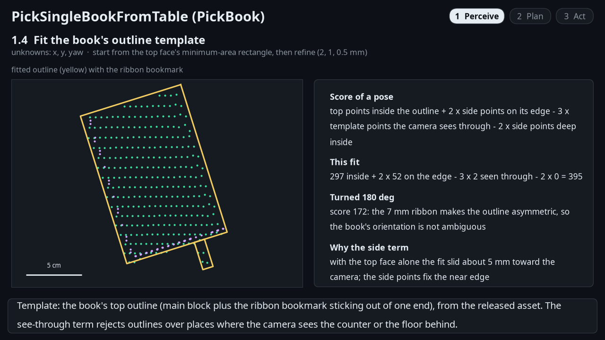</p>

**Plan.** If no edge or corner overhangs enough for a pinch, one arm first pushes the book toward the robot with the
hand tilted (8 of the seeds 900000-900019 needed this; in the video's episode the push is 5.2 cm). The pushing hand
then moves out of the head camera's view, the book is perceived again, and the pinch is planned on the new pose: the
hand tilted 40 deg (46 deg if no 40 deg plan passes), lower pad under the overhanging bottom edge, upper pad on the top face. A planning IK (`pk_ik.py`)
follows each candidate path from the current joint angles and rejects paths that bring a joint near its limit or a link
under the bookshelf's lower board.

| Phase | What it does | Ends when |
|---|---|---|
| p_reach | the pushing hand to above the book's far side | segment done |
| p_down | fingertips down to just above the counter behind the book | within 3 mm of the push start |
| p_push | pushes the book toward the robot | at the planned end point |
| p_off, p_up, p_clear | backs off, rises, moves out of the camera's view | the book is perceived again and the pinch planned |
| g_reach | the pinching hand to the pre-pinch pose | at the pose (else a new attempt) |
| g_insert | slides in under the edge | within 3 mm of the pinch pose |
| g_close | closes for 8 steps | opening below 0.12 (closed on nothing): retry; else lift |
| g_lift, g_hold | lifts the book 20 cm, holds | success |

## StackSingleBookShelf (ShelfBook)

<p align="center">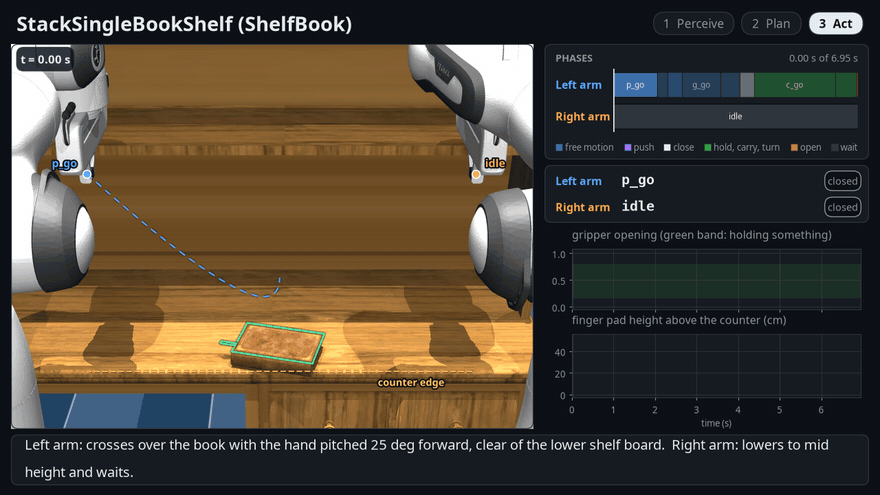</p>
<p align="center"><a href="../assets/videos/StackSingleBookShelf.mp4">Full explainer video (MP4, 47 s)</a></p>

<p align="center">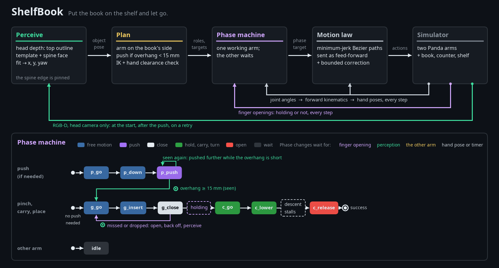</p>

**Perception** (`ss_perc.py`). As in PickBook, from head depth: a template of the top outline (main block plus ribbon),
with a spine-face term that pins the near edge, which the push and the pinch depend on. The task's yaw range (+-30 deg)
fixes which axis is which, so no flip has to be resolved.

<p align="center">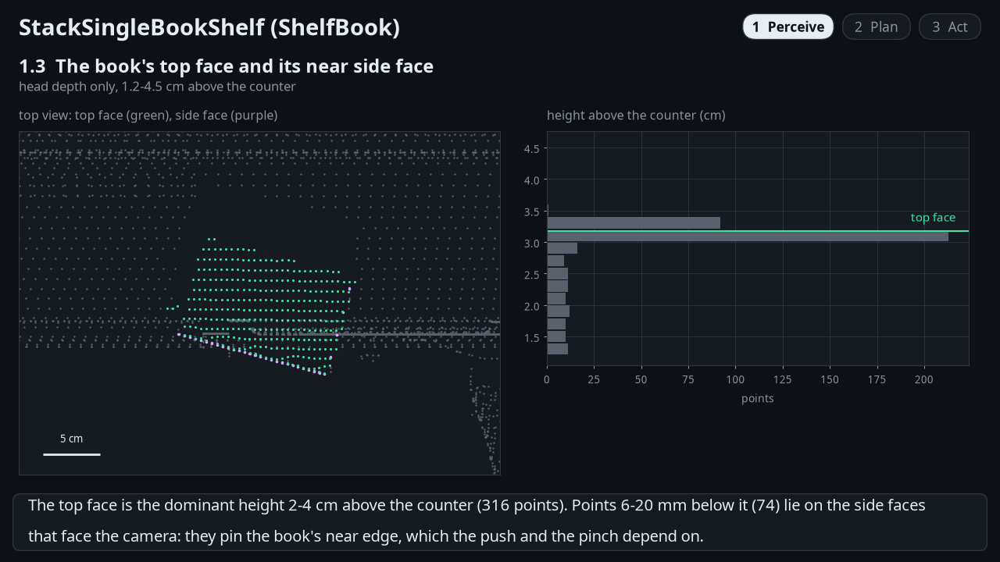 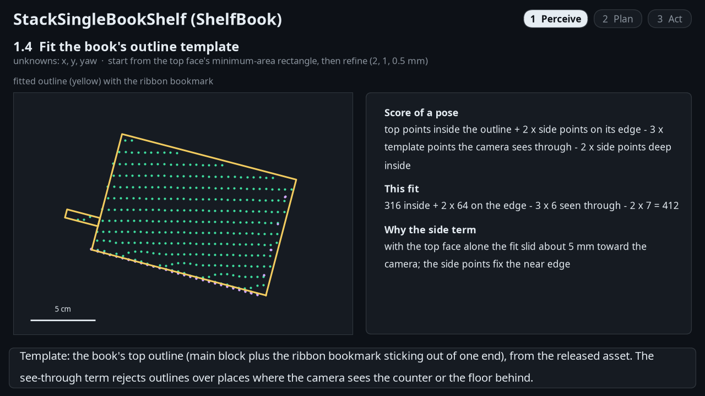</p>

**Plan.** One arm does everything: the one on the book's side (y >= 0: the left arm). The other lowers to mid height
and waits. The book is pinched across its thickness at the spine, under its centre of mass, so the spine must overhang
the counter's front edge by at least 15 mm. If it does not, the arm pushes the book's far face toward the robot with
the front finger of the open gripper (one finger touches, so the gripper never "holds" the book), to a 21 mm overhang;
the hand crosses over the book pitched 25 deg forward and pushes pitched 15 deg, clear of the lower shelf board. A
planning IK checks every candidate path for joint-range margin, and after a push a box model of the hand raises the
approach to the pinch until it clears the book, the counter and the shelf boards by 8 mm.

| Phase | What it does | Ends when |
|---|---|---|
| p_go | crosses over the book, hand pitched forward | within 1.5 cm of its via point |
| p_down | front finger down behind the far face | at the push start (4 mm in height, 6 mm in x) |
| p_push | pushes toward the robot | at the end point; the book is perceived again and the push extended if the overhang is still short |
| g_go | to the pinch pose behind the spine, fingers open | within 8 mm |
| g_insert | slides in: lower pad under the spine, upper pad on the top face | within 4 mm |
| g_close | closes for 8 steps | opening below 0.12: retry; else carry |
| c_go | lifts while turning the book nose-down, carries it in over the lower board | at the carry pose |
| c_lower | lowers until the far edge touches the board | the descent stalls |
| c_release | opens | success: the book is on the board and no gripper holds it |

---

## Limits

- Each controller is built for its task's scene and spawn ranges; it is not a general method.
- Four controllers keep development hooks through which a test harness could inject ground truth or force a choice
  (`HybridRV.wheels_override`, `HybridLT.oracle`, `HybridPK.book_source`, `HybridSS.book_source`,
  `HybridSS.force_pinch`). Each is `None` in the constructor, cannot be set from `hybrid.json`, and nothing in the
  bundle sets it.
- PickBook pushes the book with closed fingers. In a failed episode the scorer can count that push as "holding", which
  earns task-progression credit without a grasp.

---

## Making the videos

`scripts/explainer/` makes every video and GIF from scratch (RoboEval's Python environment for steps 1 and 2, any
Python with numpy, matplotlib and Pillow for steps 3 and 4, plus an ffmpeg binary):

```bash
# 1. run one episode as the evaluator does and record every step (head camera at 1280 px, observations, controller state)
MUJOCO_GL=egl python -B scripts/explainer/trace.py PackBox 900000 --res 1280 --out runs/explain/PackBox_900000
# 2. replay the controller's perception on the observation it planned from, keeping the intermediate results
python -B scripts/explainer/explain.py runs/explain/PackBox_900000
# 3. draw the frames and encode the MP4 (and the episode GIF)
python scripts/explainer/compose.py runs/explain/PackBox_900000 --out assets/videos/PackBox.mp4 \
    --gif assets/controllers/PackBox.gif --ffmpeg ffmpeg
# 4. once all seven videos exist: the README's trailer GIF and the gallery's poster tiles
python scripts/explainer/trailer.py --ffmpeg ffmpeg
# the feedback-loop diagrams (no episode needed)
python scripts/explainer/loops.py
```

`trace.py` accepts training seeds only (>= 10,000). `explain.py` checks that its replayed estimate equals the one the
controller computed during the episode, so the perception slides show exactly what the controller did. Rendering uses a
separate camera and does not change the simulation: the seven traced episodes have the same lengths as the report's
Fig. 2 runs (122, 83, 149, 81, 67, 169 and 139 steps).
